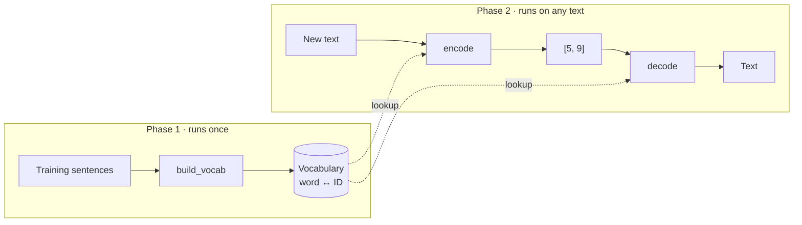

# $\color{#a3e635}{\text{01. Tokenization}}$

&nbsp;

 

## $\color{#a3e635}{\text{Problem}}$

Implement a simple **`word-level tokenizer`** that converts text into integer IDs and back.

> 📄 The original paper uses a **subword** tokenizer (byte-pair encoding). This is a simplified word-level version.

 

## $\color{#a3e635}{\text{How It Works}}$

The tokenizer works in **two phases**:

- **Phase 1:** `build_vocab` **creates** the dictionary from training data.
- **Phase 2:** `encode` and `decode` only **look up** words and IDs in it. They never add new words.

> Both phases lowercase and split text **the same way**, so words always match.

 

### $\color{red}{\text{1. Build Vocabulary — creates the dictionary}}$

1. Reserve IDs `0–3` for the special tokens.
2. Lowercase each training sentence and split it on whitespace.
3. Keep only **unique** words, **sort** them, and assign IDs starting from `4`.

| Token | ID | Role |
|:--|:--:|:--|
| PAD | 0 | Fill shorter sequences to the same length |
| UNK | 1 | Replaces any word not in the vocabulary |
| BOS | 2 | Marks the beginning of a sequence |
| EOS | 3 | Marks the end of a sequence |

**Example:** training sentences `["hello world", "this is a test", "hello test"]`

| Word | a | hello | is | test | this | world |
|:--|:--:|:--:|:--:|:--:|:--:|:--:|
| **ID** | 4 | 5 | 6 | 7 | 8 | 9 |

- `hello` appears twice but gets **one** ID.
- After this step, the vocabulary is **fixed**.

 

### $\color{red}{\text{2. Encode — text → list of IDs}}$

1. Lowercase the text and split it on whitespace.
2. **Look up** each word's ID.
3. If the word isn't in the vocabulary, use `UNK` (`1`). Nothing is added.

| Input | Output | Why |
|:--|:--|:--|
| `"hello world"` | `[5, 9]` | both words known |
| `"Hello TEST"` | `[5, 7]` | lowercased first |
| `"hello unknown"` | `[5, 1]` | `unknown` was never seen |
| `"foo bar baz"` | `[1, 1, 1]` | no word is known |

 

### $\color{red}{\text{3. Decode — list of IDs → text}}$

1. **Look up** each ID's word, or use `UNK` if the ID doesn't exist.
2. Join the words with spaces.

| Input | Output | Why |
|:--|:--|:--|
| `[5, 9]` | `"hello world"` | both IDs known |
| `[8, 6, 4, 7]` | `"this is a test"` | both IDs known |
| `[5, 99]` | `"hello UNK"` | ID `99` doesn't exist |

 

## ➡️ Code: [`solution.py`](solution.py)

 

