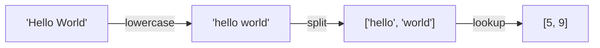

# $\color{#a3e635}{\text{01. Tokenization}}$

&nbsp;
&nbsp;

 

## Problem :

Build a simple **word-level tokenizer** with three functions:

- `build_vocab(texts)`: create the vocabulary from training sentences
- `encode(text)`: text → list of token IDs
- `decode(ids)`: token IDs → space-separated text

 

## 🏷 Special tokens

| Token | ID | Role |
|:--|:--:|:--|
| PAD | 0 | Fill shorter sequences to the same length |
| UNK | 1 | Any word not in the vocab |
| BOS | 2 | Beginning of sequence |
| EOS | 3 | End of sequence |

## 💡 Intuition

A model can't read words, only numbers. The tokenizer is a **two-way lookup table** between words and IDs.

> 📄 The paper uses **subword** tokenization (byte-pair encoding). This exercise is a simplified word-level version, enough to feed the next steps.

## 🔤 Example

Vocab built from `["hello world", "this is a test", "hello test"]`:

| ID | 0 | 1 | 2 | 3 | 4 | 5 | 6 | 7 | 8 | 9 |
|:--|:--:|:--:|:--:|:--:|:--:|:--:|:--:|:--:|:--:|:--:|
| Token | PAD | UNK | BOS | EOS | a | hello | is | test | this | world |

`"hello unknown"` → `[5, 1]` (unseen word → **UNK**)

## 🛠 Solution walkthrough

1. **build_vocab:** add the 4 special tokens first (IDs 0–3)
2. Collect lowercased words in a `set`, then **sort** them and assign IDs from 4
3. Keep both maps (`word → id` and `id → word`) and set `vocab_size`
4. **encode:** `text.lower().split()`, then `word_to_id.get(w, UNK)`
5. **decode:** `id_to_word.get(i, UNK)` and join with spaces

➡️ Code: [`solution.py`](solution.py)

## ⚠️ Pitfalls

- Not **sorting** the set → IDs change between runs.
- Forgetting to **lowercase** in `encode` → `"Hello"` becomes UNK.
- Starting word IDs at 0 → overwrites the special tokens.
- Forgetting to set `vocab_size`.

## ⏱ Complexity

Build $O(N + U \log U)$ · Encode / Decode $O(L)$, where $N$ is the total number of words, $U$ the number of unique words, and $L$ the sequence length.

 

[⬅️ Back to Transformers](../Readme.md) · [Next: Embedding Layer ➡️](../02_Embedding_Layer/)

