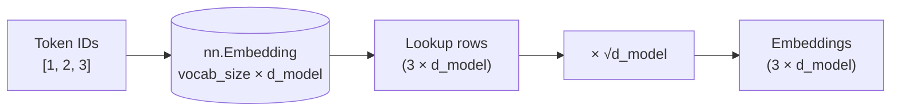

# $\color{#a3e635}{\text{02. Embedding Layer}}$

&nbsp;

 

## $\color{#a3e635}{\text{Problem}}$

Implement the Transformer's **`token embedding layer`**. It converts each token ID into a dense vector of size `d_model`, then scales the vector by multiplying to $\sqrt{d_{model}}$.

 

$$E = \text{Embedding}(\text{tokens}) \cdot \sqrt{d_{model}}$$

 

> 📄 **Reference**: Attention Is All You Need, Section 3.4.

 

## $\color{#a3e635}{\text{How It Works}}$

- **`create_embedding_layer`** builds the lookup table.
- **`embed_tokens`** looks up the IDs and scales the result.

 

### $\color{red}{\text{1. Create the layer — builds the lookup table}}$

1. Build `nn.Embedding(vocab_size, d_model)`.
2. It holds one **row per token ID**, each row a vector of size `d_model`.

| Argument | Meaning | Shape of the table |
|:--|:--|:--:|
| `vocab_size` | Number of distinct token IDs | rows |
| `d_model` | Width of each embedding | columns |

- Weights are **float32**, randomly initialised from N(0, 1).

#### Example: Token Embedding Table

- Suppose `vocab_size = 3` and `d_model = 2`.
- The embedding layer stores one row per token ID and two dimensions per embedding.

| Token ID | Dimension 1 | Dimension 2 |
|:---:|---:|---:|
| 0 | 0.6 | 0.3 |
| 1 | -0.2 | 0.8 |
| 2 | 0.4 | -0.5 |

*Note: These values are illustrative. PyTorch initializes the weights randomly.*

 

### $\color{red}{\text{2. Embed tokens — IDs → scaled vectors}}$

1. **Look up** the row for every token ID.
2. Multiply every vector by $\sqrt{d_{model}}$.
3. Keep **all leading dimensions** of `tokens`. Only add `d_model` at the end.

| `tokens` shape | Output shape |
|:--:|:--:|
| `(3,)` | `(3, d_model)` |
| `(batch, seq_len)` | `(batch, seq_len, d_model)` |

**Example:** `vocab_size = 10`, `d_model = 4`, so the scale is $\sqrt{4} = 2.0$

| `tokens` | Output | Why |
|:--|:--|:--|
| `[0]` | `[[3.8538, 2.9746, 1.8014, -4.211]]` | one row, scaled by 2 |
| `[5, 5]` | two identical rows | same ID, same vector |
| `[1, 2, 3]` | `3 × 4` matrix | one row per token |

> 💡 **Why scale?** The weights start around N(0, 1). Scaling by $\sqrt{d_{model}}$ keeps the embeddings from being drowned out by the positional encodings added next.

 

## ➡️ Code: [`solution.py`](solution.py)

 

