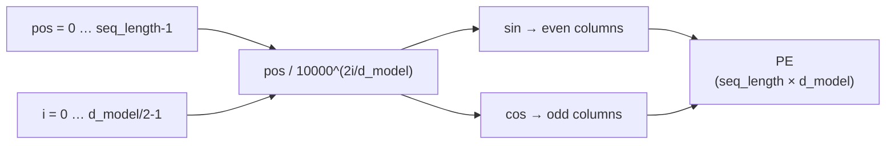

# $\color{#a3e635}{\text{03. Positional Encoding}}$

&nbsp;

 

## $\color{#a3e635}{\text{Problem}}$

Implement the fixed **`sinusoidal positional encoding`**: a matrix that tells the model *where* each token sits in the sequence.

$$PE_{(pos,\,2i)} = \sin\!\left(\frac{pos}{10000^{2i/d_{model}}}\right)$$

$$PE_{(pos,\,2i+1)} = \cos\!\left(\frac{pos}{10000^{2i/d_{model}}}\right)$$

> 📄 Section 3.5 of the paper. Attention has no notion of order, so position information is **added** to the embeddings.

 

## $\color{#a3e635}{\text{How It Works}}$

- **Rows** are positions, **columns** are embedding dimensions.
- Each pair of columns `(2i, 2i+1)` shares **one frequency**.
- The matrix depends only on `seq_length` and `d_model`. Nothing is learned.

 

### $\color{red}{\text{1. Build positions and frequencies}}$

1. Make a column of positions `0 … seq_length-1`.
2. For each pair index `i`, compute the divisor $10000^{2i/d_{model}}$.
3. Divide positions by divisors to get an angle for every `(pos, i)`.

| Pair `i` | Divisor (`d_model = 6`) | Frequency |
|:--:|:--:|:--|
| 0 | 1 | highest |
| 1 | ≈ 21.54 | medium |
| 2 | ≈ 464.16 | lowest |

- Early columns oscillate fast, later columns oscillate slowly.

 

### $\color{red}{\text{2. Fill the matrix}}$

1. Create a `float64` array of zeros with shape `(seq_length, d_model)`.
2. Put **sin(angle)** in the **even** columns `0, 2, 4, …`
3. Put **cos(angle)** in the **odd** columns `1, 3, 5, …`
4. Return it **unrounded**.

| Column | 0 | 1 | 2 | 3 | 4 | 5 |
|:--|:--:|:--:|:--:|:--:|:--:|:--:|
| **Function** | sin | cos | sin | cos | sin | cos |
| **Pair `i`** | 0 | 0 | 1 | 1 | 2 | 2 |

 

### $\color{red}{\text{3. Check with an example}}$

`seq_length = 4`, `d_model = 6`

| pos | c0 (sin) | c1 (cos) | c2 (sin) | c3 (cos) | c4 (sin) | c5 (cos) |
|:--:|:--:|:--:|:--:|:--:|:--:|:--:|
| 0 | 0.0 | 1.0 | 0.0 | 1.0 | 0.0 | 1.0 |
| 1 | 0.8415 | 0.5403 | 0.0464 | 0.9989 | 0.0022 | 1.0 |
| 2 | 0.9093 | -0.4161 | 0.0927 | 0.9957 | 0.0043 | 1.0 |
| 3 | 0.1411 | -0.99 | 0.1388 | 0.9903 | 0.0065 | 1.0 |

- **Row 0** is always `[0, 1, 0, 1, …]` since sin(0) = 0 and cos(0) = 1.
- Column 0 changes fast between rows, while column 4 barely moves.

> 💡 **Why sin/cos?** Every position gets a **unique** pattern, and $PE_{pos+k}$ is a linear function of $PE_{pos}$. This makes relative offsets easy for the model to learn.

 

## ➡️ Code: [`solution.py`](solution.py)

 

