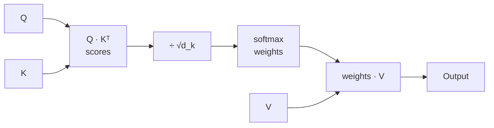

# $\color{#a3e635}{\text{04. Scaled Dot-Product Attention}}$

&nbsp;

 

## $\color{#a3e635}{\text{Problem}}$

Implement **`scaled dot-product attention`**: each token looks at all the other tokens and takes a weighted mix of their values.

$$\text{Attention}(Q, K, V) = \text{softmax}\!\left(\frac{QK^T}{\sqrt{d_k}}\right)V$$

> 📄 Section 3.2.1 of the paper.

 

## $\color{#a3e635}{\text{Input / Output}}$

| | Shape | Meaning |
|:--|:--:|:--|
| **Q** (queries) | `(batch, q_len, d_k)` | what each token is looking for |
| **K** (keys) | `(batch, k_len, d_k)` | what each token offers |
| **V** (values) | `(batch, k_len, d_v)` | the information to mix |
| **Output** | `(batch, q_len, d_v)` | one mixed vector per query |

- All tensors are `float32`. The output is **unrounded**.

 

## $\color{#a3e635}{\text{How It Works}}$

 

### $\color{red}{\text{1. Score — how well does each query match each key?}}$

Compute `Q @ Kᵀ`. This gives a `(batch, q_len, k_len)` matrix. A bigger number means a better match.

 

### $\color{red}{\text{2. Scale — divide by } \sqrt{d_k}}$

Divide the scores by the square root of `d_k` (the last dimension of `K`).

> 💡 Without this, large `d_k` gives huge scores. Softmax then becomes too sharp and learning gets unstable.

 

### $\color{red}{\text{3. Softmax — turn scores into weights}}$

Apply softmax over the **last dimension** (the keys). Each row now sums to **1**.

 

### $\color{red}{\text{4. Mix — weighted sum of values}}$

Multiply the weights by `V`. Each output is an average of the value vectors, weighted by attention.

 

### $\color{red}{\text{Example}}$

`Q = K = [[1, 0], [0, 1]]`, `V = [[1, 2], [3, 4]]`, so `d_k = 2`

1. Scores: `Q @ Kᵀ = [[1, 0], [0, 1]]`
2. Scale by `√2`: `[[0.71, 0], [0, 0.71]]`
3. Softmax per row: `[[0.67, 0.33], [0.33, 0.67]]`
4. Mix with `V`:

| Query | Weights | Output |
|:--:|:--:|:--:|
| 1st | `[0.67, 0.33]` | `[1.6605, 2.6605]` |
| 2nd | `[0.33, 0.67]` | `[2.3395, 3.3395]` |

- The 1st query matches the 1st key best, so its output leans toward `V[0]`.

 

## ➡️ Code: [`solution.py`](solution.py)

 

