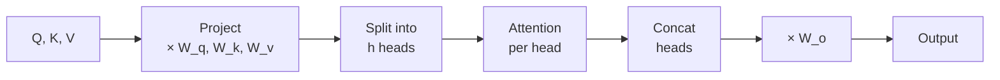

# $\color{#a3e635}{\text{05. Multi-Head Attention}}$

&nbsp;

 

## $\color{#a3e635}{\text{Problem}}$

Implement **`multi-head attention`**: run attention several times in parallel, each head on a different slice of the features, then combine the results.

$$\text{head}_i = \text{softmax}\!\left(\frac{QW_i^Q\,(KW_i^K)^T}{\sqrt{d_k}}\right)VW_i^V$$

$$\text{MHA}(Q,K,V) = \text{Concat}(\text{head}_1, \dots, \text{head}_h)\,W^O$$

> 📄 Section 3.2.2 of the paper. Here `h = num_heads` and $d_k = d_{model} / h$.

 

## $\color{#a3e635}{\text{Input / Output}}$

| | Shape | Meaning |
|:--|:--:|:--|
| **Q, K, V** | `(batch, seq_len, d_model)` | inputs |
| **W_q, W_k, W_v, W_o** | `(d_model, d_model)` | projection matrices |
| **num_heads** | `int` | number of heads (`d_model` divisible by it) |
| **Output** | `(batch, q_len, d_model)` | `float64` NumPy array |

- Each `W` matrix holds **all heads side by side**. Splitting them into heads is your job.
- The output is **unrounded**.

 

## $\color{#a3e635}{\text{How It Works}}$

 

### $\color{red}{\text{1. Project}}$

Multiply `Q`, `K`, `V` by `W_q`, `W_k`, `W_v`. The shape stays `(batch, seq_len, d_model)`.

 

### $\color{red}{\text{2. Split into heads}}$

Cut the last dimension into `h` equal parts of size `d_k = d_model / h`.

1. Reshape: `(batch, seq_len, d_model)` → `(batch, seq_len, h, d_k)`
2. Swap axes: → `(batch, h, seq_len, d_k)`

Now every head is its own small attention problem.

 

### $\color{red}{\text{3. Attention on each head}}$

Same as the previous problem, done for all heads at once:

1. Scores: `Q @ Kᵀ` → `(batch, h, q_len, k_len)`
2. Divide by `√d_k` (the **head** width, not `d_model`)
3. Softmax over the last dimension
4. Multiply by `V` → `(batch, h, q_len, d_k)`

 

### $\color{red}{\text{4. Concat and output projection}}$

1. Swap axes back: → `(batch, q_len, h, d_k)`
2. Merge the last two dimensions: → `(batch, q_len, d_model)`
3. Multiply by `W_o`

 

### $\color{red}{\text{Shape example}}$

`batch = 1`, `seq_len = 3`, `d_model = 4`, `num_heads = 2`, so `d_k = 2`

| Step | Shape |
|:--|:--:|
| Input `Q` | `(1, 3, 4)` |
| After projection | `(1, 3, 4)` |
| After split | `(1, 2, 3, 2)` |
| Scores | `(1, 2, 3, 3)` |
| Attention output | `(1, 2, 3, 2)` |
| After concat | `(1, 3, 4)` |
| After `W_o` | `(1, 3, 4)` |

> 💡 **Why many heads?** Each head can focus on a different kind of relation between tokens (for example nearby words vs. distant ones). The total cost stays the same as one big head.

 

## ➡️ Code: [`solution.py`](solution.py)

 

