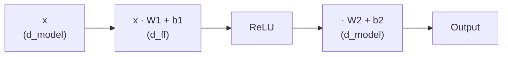

# $\color{#a3e635}{\text{06. Feed-Forward Network}}$

&nbsp;

 

## $\color{#a3e635}{\text{Problem}}$

Implement the **`position-wise feed-forward network`**: a small two-layer network applied to every token on its own.

$$\text{FFN}(x) = \text{ReLU}(xW_1 + b_1)\,W_2 + b_2$$

> 📄 Section 3.3 of the paper. Attention mixes information *between* tokens, while the FFN processes each token *individually*.

 

## $\color{#a3e635}{\text{Input / Output}}$

| | Shape | Meaning |
|:--|:--:|:--|
| **x** | `(..., d_model)` | input (any leading dimensions) |
| **W1** | `(d_model, d_ff)` | expands to the hidden width |
| **b1** | `(d_ff,)` | hidden bias |
| **W2** | `(d_ff, d_model)` | projects back to the model width |
| **b2** | `(d_model,)` | output bias |
| **Output** | `(..., d_model)` | `float64` NumPy array, same shape as `x` |

 

## $\color{#a3e635}{\text{How It Works}}$

 

### $\color{red}{\text{1. Expand}}$

Compute `x @ W1 + b1`. The last dimension grows from `d_model` to `d_ff`.

 

### $\color{red}{\text{2. ReLU}}$

Replace every negative value with `0`: `max(0, value)`.

 

### $\color{red}{\text{3. Project back}}$

Compute `hidden @ W2 + b2`. The last dimension returns to `d_model`.

 

### $\color{red}{\text{Example}}$

`d_model = 2`, `d_ff = 3`, biases are all zeros

| Step | Result |
|:--|:--|
| `x` | `[1, 2]` |
| `x @ W1` with `W1 = [[1,-1,0],[0,-1,1]]` | `[1, -3, 2]` |
| After ReLU | `[1, 0, 2]` |
| `@ W2` with `W2 = [[1,0],[0,1],[1,1]]` | `[3, 2]` |

- The `-3` became `0`, so that hidden unit is switched off.
- The output has the same shape as the input.

> 💡 In the paper, `d_model = 512` and `d_ff = 2048`. The hidden layer is 4× wider.

 

## ➡️ Code: [`solution.py`](solution.py)

 

