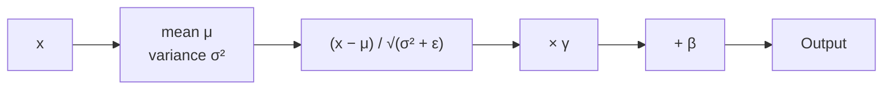

# $\color{#a3e635}{\text{07. Layer Normalization}}$

&nbsp;

 

## $\color{#a3e635}{\text{Problem}}$

Implement **`layer normalization`**: for each token, rescale its features so they have mean 0 and variance 1, then apply a learned scale and shift.

$$y = \gamma \odot \frac{x - \mu}{\sqrt{\sigma^2 + \varepsilon}} + \beta$$

> 📄 Used in the paper after every attention and feed-forward sub-layer (section 3.1).

 

## $\color{#a3e635}{\text{Input / Output}}$

| | Shape | Meaning |
|:--|:--:|:--|
| **x** | `(..., d_model)` | input (any leading dimensions) |
| **gamma** (γ) | `(d_model,)` | learned scale |
| **beta** (β) | `(d_model,)` | learned shift |
| **eps** (ε) | `float` | tiny number to avoid dividing by zero |
| **Output** | same as `x` | `float64` NumPy array |

- μ and σ² are computed **per vector**, over the **last axis** only.
- σ² is the **population** variance (divide by `d_model`, not `d_model - 1`).

 

## $\color{#a3e635}{\text{How It Works}}$

 

### $\color{red}{\text{1. Mean and variance}}$

For every feature vector, compute the mean and the variance along the **last axis**. Keep the reduced dimension (`keepdims=True`) so the shapes broadcast.

 

### $\color{red}{\text{2. Normalize}}$

Subtract the mean, then divide by $\sqrt{\sigma^2 + \varepsilon}$. Each vector now has mean 0 and variance 1.

 

### $\color{red}{\text{3. Scale and shift}}$

Multiply by `gamma` and add `beta`. This lets the model undo the normalization if it needs to.

 

### $\color{red}{\text{Example}}$

`x = [1, 2, 3, 4]`, `gamma = 1`, `beta = 0`

1. Mean: `μ = 2.5`
2. Variance: `σ² = 1.25`, so `σ ≈ 1.118`
3. Normalize each value:

| x | 1 | 2 | 3 | 4 |
|:--|:--:|:--:|:--:|:--:|
| **x − μ** | -1.5 | -0.5 | 0.5 | 1.5 |
| **÷ σ** | -1.3416 | -0.4472 | 0.4472 | 1.3416 |

With `gamma = 2` and `beta = 1`, the result is `2 · value + 1 = [-1.6833, 0.1056, 1.8944, 3.6833]`.

> 💡 **Why not batch norm?** Layer norm uses only the features of one token, so it does not depend on the batch size or on other sequences.

 

## ➡️ Code: [`solution.py`](solution.py)

 

