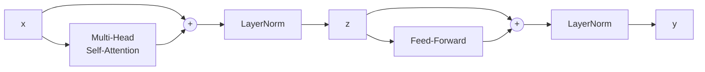

# $\color{#a3e635}{\text{08. Encoder Block}}$

&nbsp;

 

## $\color{#a3e635}{\text{Problem}}$

Implement one **`Transformer encoder block`**: self-attention, then a feed-forward network, each wrapped with a residual connection and layer normalization.

$$z = \text{LayerNorm}\big(x + \text{MHA}(x, x, x)\big)$$

$$y = \text{LayerNorm}\big(z + \text{FFN}(z)\big)$$

> 📄 Section 3.1 of the paper. This is **post-norm**: the normalization comes *after* the residual addition. It reuses the three previous building blocks.

 

## $\color{#a3e635}{\text{Input / Output}}$

| | Shape | Meaning |
|:--|:--:|:--|
| **x** | `(batch, seq_len, d_model)` | input |
| **W_q, W_k, W_v, W_o** | `(d_model, d_model)` | attention projections |
| **W1, b1, W2, b2** | `(d_model, d_ff)`, `(d_ff,)`, `(d_ff, d_model)`, `(d_model,)` | feed-forward weights |
| **gamma1, beta1** | `(d_model,)` | first layer norm |
| **gamma2, beta2** | `(d_model,)` | second layer norm |
| **num_heads** | `int` | number of attention heads |
| **Output** | `(batch, seq_len, d_model)` | `float64`, same shape as `x` |

- Use `ε = 1e-6` in both layer norms.
- Keep `layer_norm`, `multi_head_attention` and `feed_forward` as **separate top-level functions**. The hidden tests call each one directly.

 

## $\color{#a3e635}{\text{How It Works}}$

 

### $\color{red}{\text{1. Self-attention + residual + norm}}$

1. Run multi-head attention with `Q = K = V = x`.
2. **Add** the result to `x` (the residual connection).
3. Apply layer norm with `gamma1`, `beta1` to get `z`.

 

### $\color{red}{\text{2. Feed-forward + residual + norm}}$

1. Run the feed-forward network on `z`.
2. **Add** the result to `z`.
3. Apply layer norm with `gamma2`, `beta2` to get `y`.

> 💡 The residual connection lets information and gradients skip a layer, which makes deep stacks easier to train.

 

### $\color{red}{\text{Example}}$

`x = [[[1, 0]]]` (one token), identity attention weights, one head

| Step | Result |
|:--|:--|
| Attention output (one token attends to itself) | `[1, 0]` |
| `x + attention` | `[2, 0]` |
| Layer norm → `z` | `[1, -1]` |
| FFN(`z`) | `[1, 0]` |
| `z + FFN(z)` | `[2, -1]` |
| Layer norm → `y` | `[1.0, -1.0]` |

 

## ➡️ Code: [`solution.py`](solution.py)

 

