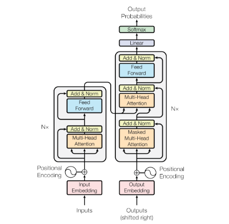

# $\color{#b31b1b}{\text{Attention Is All You Need}}$

**Year:** 2017  
**Paper:** 

## Some Foundations — (RECAP)

> Before diving into  **Attention is all you need**, let first review some fundamentals concepts to undrestand the problem the paper is trying to solve.

### $\color{Cyan}{\text{Sequences and Sequence Modeling }}$  

- **A sequence** is an ordered collection of elements, where the position of each element carry a meaning. 
    - `setence` => sequence of words 
    - `time series` => sequence of measurements

- **Sequence Modeling** is the process of learning **patterns and relationships** within **sequential data**, often to understand the sequence or predict what comes next.

### $\color{Cyan}{\text{Tokenization and Embeddings}}$ 

Before a **sequence of text** can be processed by a neural network, it must be converted into a numerical representation. This involves 3 steps : 

   1. `Tokenization` :  text is divided into smaller units. 
   2. `Token IDs` : Each token is mapped to an integer ID from the tokenizer's vocabulary.
   3. `Embeddings` :  Each token ID is mapped to a dense numerical vector that the model can process and learn from.

### $\color{Cyan}{\text{RNNs, LSTMs, and GRUs}}$

There are different ways to process sequences:

- `RNNs`: Process sequences step by step, using information from previous steps.

- `LSTMs & GRUs`: Types of RNNs that use gates to help decide what information to keep or forget, making it easier to learn from longer sequences.

- `Transformers`: Use `attention` to learn relationships between sequence elements, allowing them to be processed in parallel during training.

- `Sequence-to-Sequence (Seq2Seq)`: A setup where a model takes one sequence as input and produces another sequence as output, such as translating a sentence from one language to another.

### $\color{Cyan}{\text{Attention}}$

-  An algorithm that helps neural networks **focus on the most important parts of input data** (like words in a sentence or patches in an image) rather than treating everything equally.

 

 

## $\color{#a3e635}{\text{The Motivation}}$

Before the `Transformer` was introduced, `RNNs`, particularly `LSTMs` and `GRUs`, were widely used to process sequential data. They were successful in `Sequence-to-Sequence` tasks. However, they had some limitations : 

- **Sequential computation:** Step-by-step processing limits parallelization and increases training time & cost.

- **Long-Range Dependencies:** Learning relationships between distant tokens is difficult because information passes through successive recurrent steps.

 

> These limitations motivated researchers to explore alternative architectures.

 

## $\color{#a3e635}{\text{The Researchers' Intuition}}$

- What if an `architecture` could capture relationships between tokens directly, without processing them step by step like `RNNs` or using `convolutions`?

- `Attention` allows a neural network to focus on relevant parts of the input when processing each token.

 

> Could `attention` alone handle sequence-to-sequence tasks, without recurrence or convolutions?

 

## $\color{#a3e635}{\text{The Transformer Architecture}}$

The authors introduced the `Transformer`, an architecture that replaced slow, word-by-word sequential processing with `self-attention`, allowing entire sequences of text to be processed in parallel during training.

The original `Transformer` follows an `Encoder–Decoder` structure. The `encoder` processes the input sequence into contextual representations, while the `decoder` uses these representations to generate the output sequence.

 

Encoder-only vs. Decoder-only

Later models adopted just one  block, depending on their goals.

- **`Encoder-only` (e.g., BERT):** Focuses on **understanding text** rather than generating it. It produces representations useful for tasks like sentiment analysis, text classification, and named entity recognition.

- **`Decoder-only` (e.g., GPT):** Focuses on **generating text**. It reads a prompt and predicts the next token, then repeats this process to generate a response, making it suitable for chatbots, writing, and code generation.

 

<em>Figure from the original paper, <a href="https://arxiv.org/abs/1706.03762">Attention Is All You Need</a>.</em>

 

$\color{cyan}{\text{1. Input Embedding + Positional Encoding}}$

- Text is split into `tokens`, mapped to `token IDs`, and converted into `embeddings`.
- The Transformer processes tokens in parallel during training.
- `Positional Encodings` are added to the embeddings to provide information about the order of tokens in the sequence.

 

$\color{cyan}{\text{2. Self-Attention, the core idea}}$

Each token looks at **every other tokens** in the sequence to determine which ones are most relevant to its context.

Each token is represented by three vectors :
- **`Query`** : What information am I looking for?
- **`Key`** : What information do I contain?
- **`Value`**: what information do I pass on?

$$
\text{Attention}(Q,K,V) = \text{softmax}\left(\frac{QK^\top}{\sqrt{d_k}}\right)V
$$

**Multi-Head Attention** Runs several attention operations in parallel, allowing the model to capture different relationships between tokens.  (grammar, meaning, references…).

 

$\color{cyan}{\text{3. The Encoder and Decoder}}$

The Transformer is built from encoder and decoder blocks, each containing attention and feed-forward layers.

- `Encoder`: Uses `self-attention` to build contextual representations of the input sequence.

- `Decoder`: Uses masked `self-attention` to process previously generated tokens and encoder–decoder attention to gather information from the input representations.

 

$\color{cyan}{\text{4. Feed-Forward Networks and Residual Connections}}$

After attention, a feed-forward network further processes each token's representation. Residual connections and layer normalization help information flow through the network and support stable training.

 

$\color{cyan}{\text{5. Output Prediction}}$

Finally, the decoder's output is converted into probabilities over the vocabulary. The model uses these probabilities to predict the next token and generate the output sequence.

 

 

### $\color{#a3e635}{\text{Roadmap}}$

| # | Topic | Directory | Description | Difficulty |
|:-:|:------|:----------|:------------|:----------:|
| 01 | $\color{#ea580c}{\text{Tokenization}}$ | [`01_Tokenization/`](./01_Tokenization/) | Convert text to token IDs |  |
| 02 | $\color{#ea580c}{\text{Embedding Layer}}$ | [`02_Embedding_Layer/`](./02_Embedding_Layer/) | Map tokens to vectors |  |
| 03 | $\color{#ea580c}{\text{Positional Encoding}}$ | [`03_Positional_Encoding/`](./03_Positional_Encoding/) | Inject position via sinusoids |  |
| 04 | $\color{#ea580c}{\text{Scaled Dot-Product Attention}}$ | [`04_Scaled_Dot_Product_Attention/`](./04_Scaled_Dot_Product_Attention/) | Core QKV mechanism |  |
| 05 | $\color{#ea580c}{\text{Multi-Head Attention}}$ | [`05_Multi_Head_Attention/`](./05_Multi_Head_Attention/) | Parallel attention heads |  |
| 06 | $\color{#ea580c}{\text{Feed-Forward Network}}$ | [`06_Feed_Forward_Network/`](./06_Feed_Forward_Network/) | Position-wise MLP |  |
| 07 | $\color{#ea580c}{\text{Layer Normalization}}$ | [`07_Layer_Normalization/`](./07_Layer_Normalization/) | Normalize activations |  |
| 08 | $\color{#ea580c}{\text{Encoder Block}}$ | [`08_Encoder_Block/`](./08_Encoder_Block/) | Complete encoder layer |  |
| 🏁 | **$\color{#ea580c}{\text{Assemble \& train a Transformer}}$** | [`09_Transformer/`](./09_Transformer/) | End-to-end |  |

