 

 

<!-- 
 -->

### What's inside

- 📄 **ML research papers** — understand the core ideas behind important papers
- 🧠 **From-scratch implementations** — rebuild the key algorithms and components
- 🔢 **NumPy-first** — understand the mathematics before relying on frameworks

 

## $\color{#a3e635}{\text{Tracks}}$

### $\color{#c084fc}{\text{ML Research}}$

- Working through key ML papers in [`ML-research`](/ML-research/README.md)

| # | Paper | ArXiv | Year | Folder |
|:-:|:-----:|:-----:|:----:|:------:|
| 1 | $\color{#22d3ee}{\textbf{Attention Is All You Need}}$ |  | 2017 | [📂 Transformers](/ML-research/Transformers/) |
| 2 | $\color{#22d3ee}{\textbf{Kimi K3}}$ | [Link](https://arxiv.org/abs/2607.24653) | 2026 | `kimi-k3` |
| 3 | $\color{#22d3ee}{\textbf{ResNet}}$ | [Link](https://arxiv.org/abs/1512.03385) | 2015 | `resnet` |
| 4 | $\color{#22d3ee}{\textbf{Word2Vec}}$ | [Link](https://arxiv.org/abs/1301.3781) | 2013 | `word2vec` |
| 5 | $\color{#22d3ee}{\textbf{DenseNet}}$ | [Link](https://arxiv.org/abs/1608.06993) | 2016 | `densenet` |
| 6 | $\color{#22d3ee}{\textbf{BERT}}$ | [Link](https://arxiv.org/abs/1810.04805) | 2018 | `bert` |
| 7 | $\color{#22d3ee}{\textbf{VGG}}$ | [Link](https://arxiv.org/abs/1409.1556) | 2014 | `vgg` |

 

## 🤝 Contributing

- Found a **cleaner solution** or a **mistake in an explanation** ?
- Open an issue or PR, explanations matter as much as code here.

 

Not affiliated with TensorTonic. Problem statements are summarized in my own words.  
For the original problems, visit <a href="https://www.tensortonic.com">TensorTonic</a>.

If you find this useful, consider giving the repository a ⭐ .

